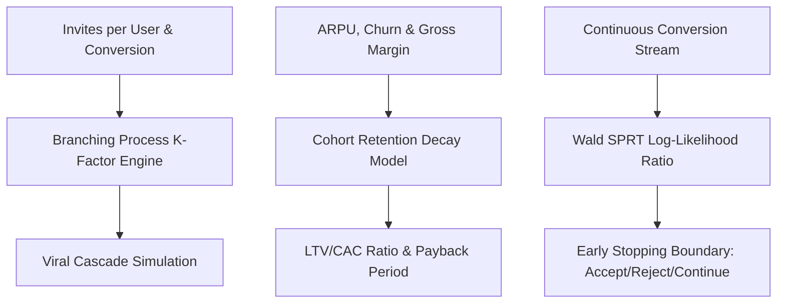

# genpark-growth-agent


GenPark Growth Agent has a standard-library core for quantitative growth engineering and experimentation engine implementing viral branching process epidemic modeling ($K$-factor), SaaS cohort retention and CAC payback decay analysis, and Wald's Sequential Probability Ratio Test (SPRT) for continuous A/B test early stopping.



## MCP runtime requirements

Use Python 3.10 or newer. The core `client.py` uses only the standard library; `mcp_server.py` requires the official `mcp` SDK (`mcp>=1.0.0,<2`). From this repository's checkout, create an isolated environment and install its requirements:

```bash
python -m venv .venv
.venv/bin/python -m pip install -r requirements.txt
```

On Windows, use `.venv\Scripts\python.exe` instead. You may use an existing Python environment with the requirements installed. Configure your MCP client with that interpreter's absolute path and the absolute path to `mcp_server.py`. The client launches a local STDIO process; the GitHub repository URL is not a remote MCP endpoint.

Example client configuration (replace the placeholder paths):

```json
{
  "mcpServers": {
    "genpark-growth-agent": {
      "command": "/absolute/path/to/genpark-growth-agent/.venv/bin/python",
      "args": [
        "/absolute/path/to/genpark-growth-agent/mcp_server.py"
      ]
    }
  }
}
```

## Features
- **Branching Viral Modeling**: Calculates exact geometric cascade curves and super/sub-critical thresholds ($K = i \times c$).
- **SaaS Unit Economics**: Models cohort retention decay curves, net lifetime value ($LTV = ARPU \cdot Margin / Churn$), and CAC payback months.
- **Wald's SPRT Early Stopping**: Minimizes experimentation sample size and sample waste by terminating continuous A/B tests immediately upon significance.

## Quickstart

```python
from client import GenParkGrowthAgent

growth = GenParkGrowthAgent()
res = growth.simulate_viral_k_factor_branching(initial_users=1000, invites_per_user=3.5, invite_conversion_rate=0.35)
print("K-Factor:", res["k_factor"], "Total Reached:", res["total_users_reached"])
```

## License
MIT
