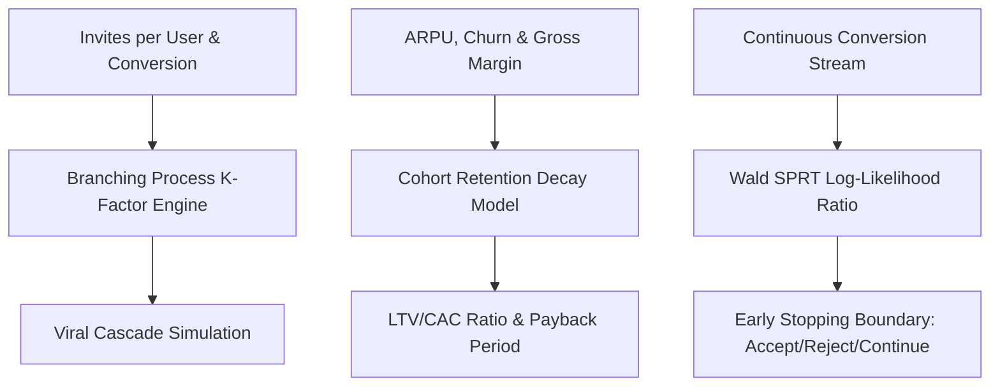

# genpark-growth-agent


GenPark Growth Agent is a zero-dependency quantitative growth engineering and experimentation engine implementing viral branching process epidemic modeling ($K$-factor), SaaS cohort retention and CAC payback decay analysis, and Wald's Sequential Probability Ratio Test (SPRT) for continuous A/B test early stopping.



## Features
- **Branching Viral Modeling**: Calculates exact geometric cascade curves and super/sub-critical thresholds ($K = i \times c$).
- **SaaS Unit Economics**: Models cohort retention decay curves, net lifetime value ($LTV = ARPU \cdot Margin / Churn$), and CAC payback months.
- **Wald's SPRT Early Stopping**: Minimizes experimentation sample size and sample waste by terminating continuous A/B tests immediately upon significance.

## Quickstart

```python
from client import GenParkGrowthAgent

growth = GenParkGrowthAgent()
res = growth.simulate_viral_k_factor_branching(initial_users=1000, invites_per_user=3.5, invite_conversion_rate=0.35)
print("K-Factor:", res["k_factor"], "Total Reached:", res["total_users_reached"])
```

## License
MIT
